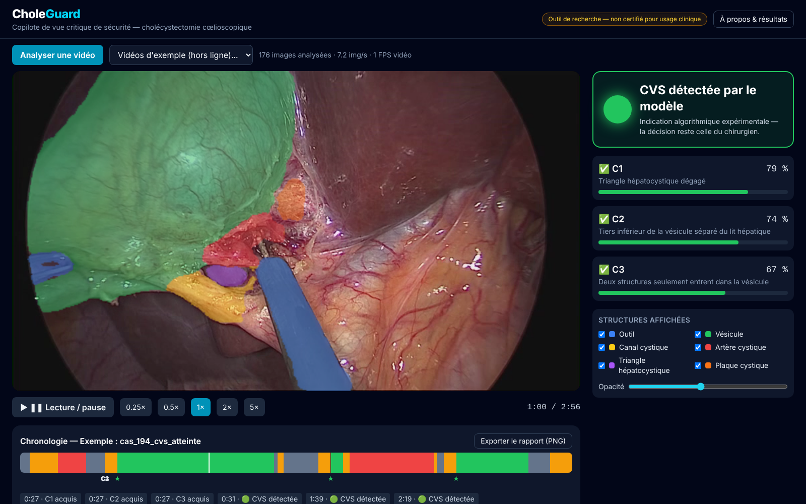

# CholeGuard — Critical View of Safety assistant for laparoscopic cholecystectomy

[Version française](README.md) · Trained model: [huggingface.co/AZAS123/choleguard](https://huggingface.co/AZAS123/choleguard)



> ⚠️ Research tool, not certified for clinical use. It never replaces the surgeon's judgement.

CholeGuard analyses laparoscopic cholecystectomy video locally (no external API). It segments the relevant anatomy (gallbladder, cystic duct, cystic artery, hepatocystic triangle, cystic plate, tools), assesses the three **Critical View of Safety** criteria **from the structures it recognised**, and shows a 4-state signal: 🔴 not reached · 🟠 partial (missing criterion shown) · 🟢 CVS detected by the model · ⚪ uncertain (blurry, dark, smoky frame or low confidence).

## Key results (Endoscapes2023 official test split, 40 unseen videos, video-level bootstrap CIs)

| Variant | mAP | mean balanced accuracy |
|---|---|---|
| A — image only | 41.2 % | 63.6 % |
| B without masks (same capacity) | 43.8 % | 64.8 % |
| **B anatomy-guided** | **50.4 %** | **70.2 %** |

- False green rate on non-CVS frames: **1.9 %** (thresholds tuned on validation only, ≤ 2 % budget).
- Segmentation Dice: tools 0.92, gallbladder 0.89, cystic duct 0.44, cystic artery 0.42, triangle 0.20, cystic plate 0.12.
- Inter-expert agreement (Fleiss' κ, test): C1 0.28, C2 0.52, C3 0.45 — the task is intrinsically ambiguous.
- CPU inference: 7 frames/s on 2 cores (ONNX Runtime, EfficientNet-B2 + FPN, 256×448).

## Run

```bash
make models && docker compose up --build   # http://localhost:8000
```

Training is fully reproducible on a free Kaggle GPU with `notebooks/kaggle_train.ipynb`. Tests: `make test`.

## Data & ethics

Endoscapes2023 (CAMMA) and CholecSeg8k, CC BY-NC-SA 4.0, non-commercial research use; no raw data is redistributed here. Single-centre data: performance on other equipment is unknown. Not a medical device.

Author: **Azddine EL HAMDAOUI** — ENSA Béni Mellal.
