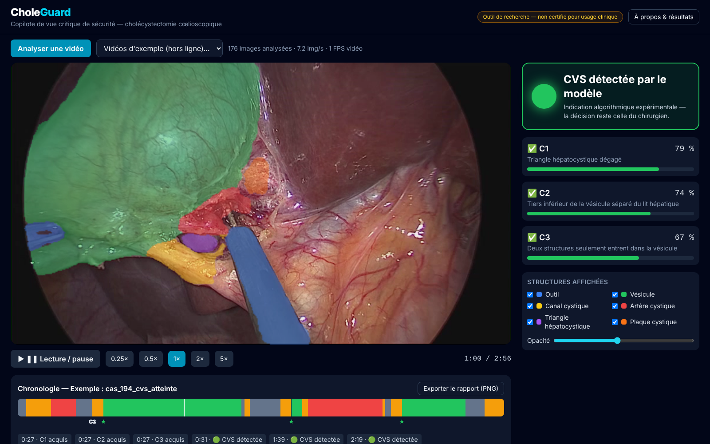
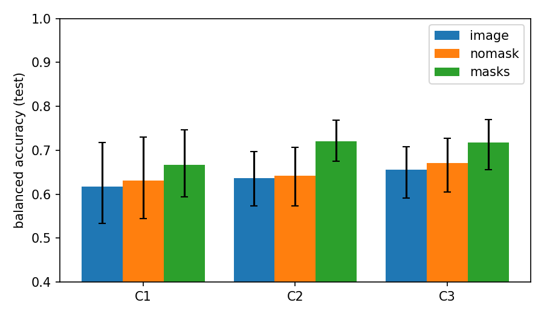
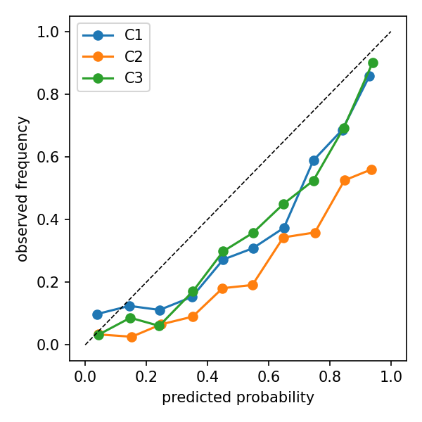

# CholeGuard

**Copilote de vue critique de sécurité pour la cholécystectomie cœlioscopique**

[English version](README.en.md) · Modèle entraîné : [huggingface.co/AZAS123/choleguard](https://huggingface.co/AZAS123/choleguard)



> ⚠️ Outil de recherche, non certifié. Il ne remplace jamais le jugement du chirurgien.

## Le problème clinique

L'ablation de la vésicule biliaire par cœlioscopie est l'une des opérations les plus pratiquées au monde. La complication la plus redoutée est la section de la **voie biliaire principale**, confondue avec le canal cystique. Pour l'éviter, le chirurgien ne doit couper qu'après avoir obtenu la **vue critique de sécurité** (*Critical View of Safety*, CVS), définie par trois critères visuels :

| | Critère |
|---|---|
| **C1** | Le triangle hépatocystique est dégagé |
| **C2** | Le tiers inférieur de la vésicule est séparé du lit hépatique |
| **C3** | Deux structures seulement entrent dans la vésicule |

Ce contrôle est souvent mal évalué, surtout en formation.

## Ce que fait CholeGuard

CholeGuard analyse la vidéo opératoire, entièrement en local, sans aucune API externe :

1. il **colore l'anatomie** : vésicule, canal cystique, artère cystique, triangle hépatocystique, plaque cystique et instruments ;
2. il **évalue les 3 critères** CVS **à partir des structures qu'il a reconnues** ;
3. il affiche un **signal à 4 états** :
   - 🔴 CVS non atteinte ;
   - 🟠 CVS partielle (le critère manquant est indiqué) ;
   - 🟢 CVS détectée par le modèle ;
   - ⚪ incertain : image floue, noire, enfumée ou modèle hésitant. Le système ne passe jamais au vert par défaut.

Il s'adresse à deux utilisateurs :

- **l'interne pendant l'opération**, qui dispose d'un second regard ;
- **l'enseignant après l'opération**, qui relit la vidéo avec une frise chronologique et peut exporter un rapport.

## Contribution : une décision guidée par l'anatomie

Un classifieur classique regarde l'image entière. CholeGuard procède comme un chirurgien : il localise d'abord les structures, puis il juge. La tête CVS reçoit, pour chaque structure, les caractéristiques visuelles moyennées **à l'intérieur de son masque** et sa surface visible. Elle est entraînée sur les masques *prédits*, avec abandon aléatoire de masques, pour tolérer les erreurs de segmentation.

Pour mesurer l'apport réel des masques, trois variantes sont entraînées sur le même réseau gelé, avec la même graine et les mêmes hyperparamètres :

| Variante | Description |
|---|---|
| A — image seule | tête CVS sur l'image globale |
| B sans masques | même tête que B, masques remplacés par des zéros (capacité identique) |
| **B guidé par l'anatomie** | tête CVS avec masques par structure |

## Résultats

Résultats sur le jeu de **test officiel d'Endoscapes2023** : 40 vidéos, jamais vues à l'entraînement, découpage par vidéo. Les intervalles de confiance à 95 % sont obtenus par bootstrap sur les vidéos.

### Évaluation des critères CVS

| Variante | mAP | Précision équilibrée moyenne |
|---|---|---|
| A — image seule | 41,2 % | 63,6 % |
| B sans masques | 43,8 % | 64,8 % |
| **B guidé par l'anatomie** | **50,4 %** | **70,2 %** |

Détail par critère pour le modèle guidé, en précision équilibrée [IC 95 %] :

- C1 : 66,7 % [59,3 – 74,6]
- C2 : 72,0 % [67,5 – 76,9]
- C3 : 71,7 % [65,6 – 77,0]



Le guidage par l'anatomie améliore les trois critères. Le gain vient bien des masques et non du réseau, puisque « B sans masques » a exactement la même taille.

### Segmentation (Dice, test)

| Instruments | Vésicule | Canal cystique | Artère cystique | Triangle hépatocystique | Plaque cystique |
|---|---|---|---|---|---|
| 0,92 | 0,89 | 0,44 | 0,42 | 0,20 | 0,12 |

Les petites structures restent difficiles : 493 images annotées seulement, dont 343 pour l'entraînement.

### Signal 🔴🟠🟢⚪

Les seuils sont réglés **sur la validation uniquement**, sous la contrainte d'au plus 2 % de faux verts. Ils sont versionnés dans [`configs/thresholds.yaml`](configs/thresholds.yaml).

- **Faux feux verts** sur le test : **1,9 %** des images où la CVS n'est pas atteinte.
- **Vidéos où la CVS est détectée** au moins une fois : 46 % (6 sur 13). Le système privilégie volontairement la prudence.
- Sur vidéo continue, un lissage minimal (constante de temps de 3 s) supprime le clignotement du signal.

### Accord entre experts

Les annotations CVS d'Endoscapes viennent de 3 chirurgiens. Leur accord est seulement modéré. Sur le test, le kappa de Fleiss vaut 0,28 pour C1, 0,52 pour C2 et 0,45 pour C3. Le problème est donc intrinsèquement ambigu, et ce niveau d'accord sert de référence pour interpréter les scores du modèle.



## Limites

- Les données proviennent d'**un seul centre** (Endoscapes2023, 201 vidéos). Les performances sur d'autres équipements sont inconnues.
- Les annotations ne sont échantillonnées que toutes les 5 secondes. Le « temps jusqu'à la CVS » n'est donc qu'approximatif.
- Le modèle peut annoncer la CVS **en avance** sur l'avis des experts : dans un exemple de démonstration, environ 50 s plus tôt. C'est la raison de la formulation « CVS détectée par le modèle », jamais « vous pouvez couper ».
- Ne pas interpréter en cas d'anatomie inhabituelle, de saignement important ou d'image dégradée (⚪).

## Utilisation

```bash
make models                 # télécharge le modèle ONNX et les résultats depuis Hugging Face
docker compose up --build   # puis http://localhost:8000
```

Sans Docker :

```bash
pip install -e ".[api]" && bash scripts/download_models.sh
cd frontend && npm ci && npx vite build && cd ..
uvicorn backend.app:app --port 8000
```

Vidéos d'exemple : elles sont construites à partir des images de test d'Endoscapes, dont la licence interdit la redistribution brute, avec `python scripts/make_sample.py --frames-dir <endoscapes>/test --video 194 --start 20300 --end 24675 --name cas_194`.

Vitesse : 7 images/s sur 2 cœurs CPU, sans GPU (ONNX Runtime, EfficientNet-B2 + FPN, 256×448).

## Reproduire l'entraînement

Tout l'entraînement tourne sur le GPU gratuit de Kaggle avec [`notebooks/kaggle_train.ipynb`](notebooks/kaggle_train.ipynb), qui appelle [`scripts/kaggle_pipeline.sh`](scripts/kaggle_pipeline.sh) :

1. statistiques des données et accord inter-experts ;
2. segmentation : pré-entraînement sur CholecSeg8k, affinage sur Endoscapes Seg50, choix entre EfficientNet-B2 et MiT-B0 sur la validation ;
3. têtes CVS : les 3 variantes, puis calibration par température ;
4. évaluation complète et réglage des seuils sur la validation ;
5. export ONNX vérifié (écart PyTorch/ONNX inférieur à 1e-3) et publication sur Hugging Face.

Tests : `make test`, soit 77 tests Python et 9 tests de l'interface.

## Architecture

```
vidéo ─► contrôle qualité (netteté, luminosité) ─┐
      └► EfficientNet-B2 + FPN ─► masques (7 classes) ─► pooling par structure ─► tête CVS ─► C1 C2 C3 (calibrés)
                                                                                                 │
                         signal : lissage + hystérésis + confirmation ◄──────────────────────────┘
                                   └─► 🔴 🟠 🟢 ⚪  ─► API FastAPI ─► interface React
```

| Dossier | Contenu |
|---|---|
| `src/choleguard/` | données, modèle, pertes, métriques, signal, inférence |
| `scripts/` | entraînement, évaluation, export, vidéos d'exemple |
| `backend/` | API FastAPI : analyse asynchrone, exemples hors ligne |
| `frontend/` | interface React (lecteur, masques, critères, frise, rapport) |

## Données et éthique

- **Endoscapes2023** (CAMMA, Université de Strasbourg) et **CholecSeg8k** sont publiés sous licence **CC BY-NC-SA 4.0**, pour un usage scientifique non commercial. Aucune donnée brute n'est incluse dans ce dépôt.
- Les vidéos sont anonymisées par les auteurs : les images prises hors du corps du patient sont noircies.
- Le projet est réservé à un usage académique. Il ne s'agit pas d'un dispositif médical.

## Auteur

**Azddine EL HAMDAOUI**, élève ingénieur en IA et cybersécurité à l'ENSA Béni Mellal. Voir [`CITATION.cff`](CITATION.cff).
